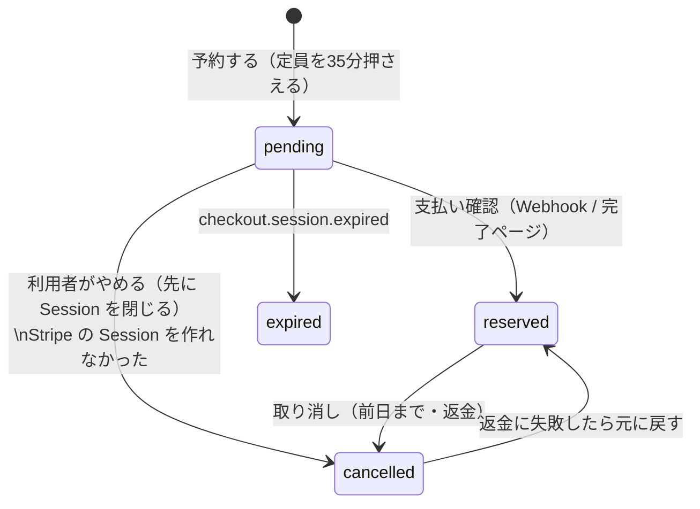

# 八幡平収穫体験 設計書（自分用メモ）

最終更新: 2026-11-20 ／ コードと食い違ったら、コードが正しい。直したらここも直す。

## 1. 何のアプリか

農産物の生産者が「収穫する権利（収穫体験）」を販売するアプリ。大根抜き・ミカン狩り・ブルーベリー狩りなど。
**作物の種類は限定しない**。生産者が作物名を自由に入力して、どんな作物でも出品できる。
時期・持ち帰りの量・値段・1日の定員も、生産者が体験ごとに決める。利用者は日付と人数を選び、Stripe でカード払いして予約を確定する。

技術: Python 3.14 / Flask 3.1 / SQLAlchemy 2 / Flask-Migrate / Flask-Login / Flask-WTF / Pillow / Stripe Checkout / SQLite（開発）

## 2. 用語

| 用語 | 意味 | コード |
|---|---|---|
| 生産者 | 体験を出品する人 | `User.role = "producer"` |
| 利用者 | 体験を予約する人 | `User.role = "customer"` |
| 体験 | 出品される収穫体験 | `Experience` |
| 作物名 | 生産者が自由に入力する作物の名前。種類は限定しない（例: ズッキーニ、栗） | `Experience.crop_name` |
| 分類 | イラストと絞り込みに使う12の分類。当てはまらない作物は「その他の作物」 | `categories.py` の `CATEGORIES` |
| 予約 | 来園日・人数・金額 | `Reservation` |
| 押さえ | 支払い待ちの間、定員を確保しておくこと（35分） | `hold_until` |

## 3. 権限

| 操作 | 未ログイン | 利用者 | 生産者 |
|---|---|---|---|
| 体験を探す・詳細を見る（公開中） | ○ | ○ | ○ |
| 非公開の体験の詳細 | 404 | 404 | 自分の体験だけ |
| 予約・支払い | ログインへ | ○ | ○（自分の体験は不可） |
| 予約の詳細・取り消し | ログインへ | 自分の予約だけ（他人は403） | 同左 |
| 出品管理（作成・編集・削除・写真） | ログインへ | 403 | 自分の体験だけ（他人は403） |
| 予約の確認（生産者向け） | ログインへ | 403 | 自分の体験の確定済み予約だけ |

- ロールは `@role_required(Role.PRODUCER)`、所有者は `get_own_experience_or_403` / `get_own_reservation_or_403` で確かめる
- 体験の出品者 ID はフォームから受け取らない（`current_user.id` を使う）
- 管理者ロールは無い（未実装）

## 4. 画面と URL

| 画面 | URL | メソッド | 備考 |
|---|---|---|---|
| トップ | `/` | GET | 分類の一覧・いまが旬・新着 |
| 体験をさがす | `/experiences` | GET | 絞り込み: `q`（タイトル・作物名・説明・住所）`category` `prefecture` `month`、最大60件 |
| 体験の詳細 | `/experiences/<id>` | GET | 写真ギャラリー（CSS のみ）・予約フォーム・キャンセル規定 |
| 会員登録 | `/register` | GET/POST | 利用者 |
| 生産者登録 | `/producer/register` | GET/POST | 農園名・都道府県・紹介文・同意チェック |
| ログイン | `/login` | GET/POST | `?next=` は同じサイトのパスだけ |
| ログアウト | `/logout` | POST | |
| 出品管理 | `/producer/` | GET | |
| 体験の出品 | `/producer/experiences/new` | GET/POST | |
| 体験の編集 | `/producer/experiences/<id>/edit` | GET/POST | 写真の追加もここ |
| 体験の削除 | `/producer/experiences/<id>/delete` | POST | これからの予約があれば不可。過去の予約があれば非公開にするだけ |
| 写真の削除 | `/producer/photos/<id>/delete` | POST | |
| 予約の確認 | `/producer/reservations` | GET | 確定済みで来園日が今日以降 |
| 予約する | `/reservations/new/<experience_id>` | POST | 支払い待ちを作り、Stripe へ 303 |
| 予約一覧 | `/reservations/` | GET | |
| 予約の詳細 | `/reservations/<id>` | GET | 支払う／やめる／取り消す |
| 支払いを再開 | `/reservations/<id>/pay` | POST | Session が open なら Stripe へ |
| 決済完了（戻り先） | `/reservations/<id>/complete?session_id=` | GET | session_id が保存値と一致するときだけ |
| 取り消し | `/reservations/<id>/cancel` | POST | 支払い待ち→Session を閉じる／確定済み→返金 |
| Stripe Webhook | `/stripe/webhook` | POST | CSRF 対象外。署名で確かめる |

## 5. データベース

### users
| 列 | 型 | 備考 |
|---|---|---|
| id | int PK | |
| email | String(255) unique | 小文字にして保存 |
| password_hash | String(255) | werkzeug |
| name | String(50) | |
| role | String(20) | customer / producer |
| farm_name / prefecture / farm_intro | | 生産者だけ |
| created_at | datetime | |

### experiences
| 列 | 型 | 制約 |
|---|---|---|
| id | int PK | |
| producer_id | FK users | |
| title | String(80) | |
| crop_name | String(50) | 作物名。自由入力（必須）。種類は限定しない |
| category | String(20) | 分類。`CATEGORIES` のキー（イラストと絞り込み用。該当なしは `other`） |
| description | Text | |
| prefecture / address | String(10) / String(200) | |
| season_start / season_end | date | start ≤ end、期間は1年以内（フォーム） |
| hours | String(50) | 例 9:00〜15:00 |
| take_home_amount / take_home_unit | int / String(10) | 1〜1000、単位は `UNITS` |
| price | int | 100〜100,000円/人 |
| daily_capacity | int | 1〜500人/日 |
| is_published | bool | |

### experience_photos
id / experience_id / filename（UUID.jpg）/ position（0が表紙）。1体験8枚まで。

### reservations
| 列 | 型 | 備考 |
|---|---|---|
| id | int PK | |
| user_id / experience_id | FK | |
| visit_date | date | |
| people | int | 1〜20 |
| unit_price / total | int | 予約時の値段。`total = unit_price * people`（CHECK） |
| status | String(20) | pending / reserved / cancelled / expired |
| hold_until | datetime | 支払い待ちの押さえの期限 |
| stripe_session_id | String(255) unique | |
| stripe_payment_intent_id | String(255) | 返金に使う |
| paid_at / refunded_at | datetime | |
| cancel_fee / refund_amount | int | 取り消し時に記録 |

### login_failures
key（`email:...` / `ip:...`）/ created_at。15分より古いものは消す。

マイグレーション: `migrations/versions/`（initial → stripe → cancel fee → crop_name）

## 6. 予約の状態



- 状態の変更は、すべて「今の状態が○○なら」の条件付き UPDATE（`services/booking.py`）。2回走っても変わるのは1回
- `pending` で `hold_until` を過ぎたものは、DB 上は pending のままでも「期限切れ」として扱う（定員に数えない・画面は「期限切れ」）
- cancelled / expired のあとに支払いが届いたら、キャンセル料なしで全額を自動返金する

## 7. 定員の数え方

定員を使っている予約 = `reserved` ＋ `hold_until` が未来の `pending`。
体験の行をロック（`with_for_update`。SQLite は `BEGIN IMMEDIATE`）してから数えるので、同時に予約されても定員を超えない。

予約できる条件（`create_reservation`）:
- 公開中、自分の体験ではない
- 来園日が明日以降で、受付期間内
- 人数 1〜20、残り定員以内
- 支払い待ちの予約を持っていない（1人1件まで）
- これからの予約（確定＋押さえ中）が10件未満

## 8. 決済（Stripe Checkout）

1. `create_reservation` で pending を作る（commit）
2. `payment.create_checkout_session` で Session を作る。金額は予約の `unit_price` × `people`。JPY なので円のまま。有効期限31分（押さえ35分より短く）
3. 失敗したら `cancel_pending` で押さえを戻す
4. `stripe_session_id` を保存して Stripe へ 303
5. 支払い後、Webhook（`checkout.session.completed`）か完了ページの早いほうが `confirm_payment` を呼ぶ
   - `payment_status == "paid"`、`metadata.reservation_id`、`amount_total == total`、`currency == "jpy"` を確かめる。合わなければ確定しない
6. Webhook の署名は `stripe.Webhook.construct_event`（生の本文、許容300秒）。返金に失敗したら 500 を返して Stripe に再送させる

Stripe を呼ぶのは `services/payment.py` だけ。ビューは `current_app.extensions["payment"]` 経由。テストは `tests/conftest.py` の `FakePayment`。
返金の idempotency key は `refund-reservation-{id}-{amount}`。

## 9. キャンセル規定

| 取り消す日 | キャンセル料 | 返金 |
|---|---|---|
| 2日前まで | 0円 | 全額 |
| 前日 | 料金の50％（1円未満切り捨て） | 残り |
| 当日以降 | 取り消し不可 | — |

- `booking.cancellation_fee(reservation, today)`、率は `DAY_BEFORE_FEE_PERCENT = 50`
- 「前日」はサーバーの日付（`date.today()`）で判断している ← 本番が日本時間でなければ要修正

## 10. 写真

- 拡張子（jpg/jpeg/png/webp）→ 中身を Pillow で開いて JPEG/PNG/WebP だけ → 5MB 以下 → 4,000万画素以下
- 向きを直し、長辺1600px に縮め、JPEG に作り直す（EXIF・GPS が消える）
- ファイル名は UUID。削除は `Path(filename).name` だけを使う
- 写真が無い体験は、分類のイラスト（`static/img/crops/*.svg`）を表示

## 11. セキュリティの決めごと

- CSRF: アプリ全体（Flask-WTF）。状態を変える操作はすべて POST。対象外は Webhook だけ
- ログイン: 同じメールで15分に5回、同じ IP で20回失敗するとロック（429）。存在しないメールでもハッシュを計算して応答時間をそろえる。登録済みかどうかが分からない文言にする
- `safe_next`: `\` を `/` にしてから、scheme・netloc・`//`・制御文字を弾く
- ヘッダー: CSP（`default-src 'self'`、`form-action` に checkout.stripe.com、`frame-ancestors 'none'`）、nosniff、X-Frame-Options、本番は HSTS
- テンプレートで `|safe` を使わない。外部 CDN を使わない
- 本番は `APP_ENV=production`。SECRET_KEY と TRUSTED_HOSTS が無いと起動しない。Cookie は Secure / HttpOnly / SameSite=Lax
- SQL は SQLAlchemy の式だけ。検索の LIKE は `%` `_` をエスケープ

## 12. 設定（`.env`）

| 名前 | 用途 |
|---|---|
| APP_ENV | development / production |
| SECRET_KEY | 本番必須 |
| TRUSTED_HOSTS | 本番必須（カンマ区切り） |
| DATABASE_URL | 省略時 `instance/harvest.sqlite`。`postgres://` / `postgresql://` は psycopg のドライバーに読み替える |
| STRIPE_SECRET_KEY | sk_test_... |
| STRIPE_WEBHOOK_SECRET | whsec_...（開発は `stripe listen` が出す値） |
| SEED_PASSWORD | `flask seed` で作るサンプルのアカウントのパスワード。本番は必須 |
| TZ | `Asia/Tokyo`。キャンセル料の「前日」を日本時間で判断する（Render は render.yaml で設定） |
| RENDER_EXTERNAL_HOSTNAME | Render が自動で入れる公開ホスト名。TRUSTED_HOSTS が無いときに使う |

## 13. ファイル構成

```
harvest/
  __init__.py        create_app、設定、セキュリティヘッダー、フィルター（yen, date_jp）
  categories.py      分類（イラスト用）・単位・都道府県
  models.py          User / Experience / ExperiencePhoto / Reservation / LoginFailure
  forms.py           Flask-WTF のフォーム
  security.py        safe_next、ログインの回数制限、CSP
  uploads.py         写真の検査と作り直し
  commands.py        flask seed
  services/
    booking.py       予約・定員・状態の変更・キャンセル料
    payment.py       Stripe（ここだけ）
    checkout.py      Stripe の結果を予約に反映（返金を含む）
  views/             auth / shop / producer / reservations / webhooks
  templates/         画面
  static/            style.css、img/crops/*.svg
tests/               conftest（FakePayment）、auth / producer / reservations / webhooks
```

## 14. まだやっていないこと・決めること

- [ ] 生産者への入金（Stripe Connect）。今は運営がまとめて受け取る
- [ ] 前日キャンセル料50％の取り分（運営か生産者か）
- [ ] 日付の判断を、TZ に頼らずコードで日本時間に固定する（今は Render の TZ=Asia/Tokyo で対応）
- [ ] 管理者の画面（生産者の承認、不適切な出品の非公開など）
- [ ] 予約確定・取り消しのメール通知
- [x] 公開: Render（render.yaml）＋ PostgreSQL。PostgreSQL 16 でテスト53件とマイグレーションを確認済み
- [ ] 写真の保存先を外部ストレージにする（無料プランでは再起動で消える）
- [ ] 当日の受付（予約番号の確認）
- [ ] WTForms の SelectField の警告（選択肢をタプルで渡す書き方が 3.4 で廃止予定）
